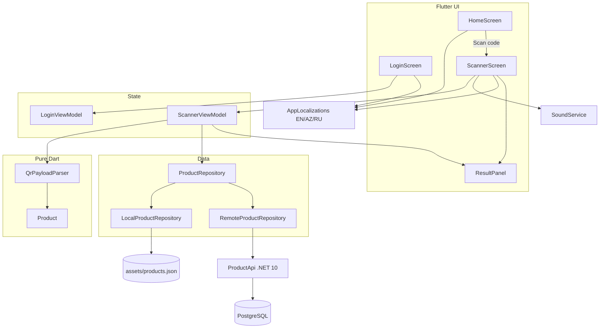
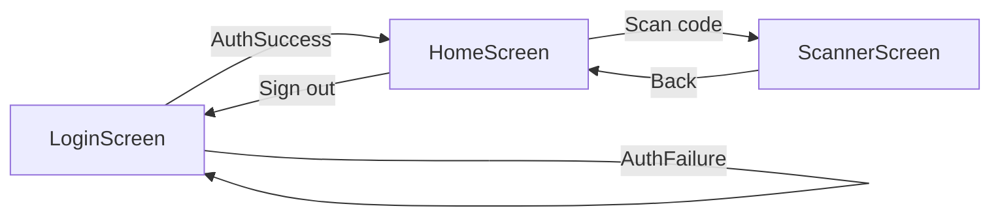
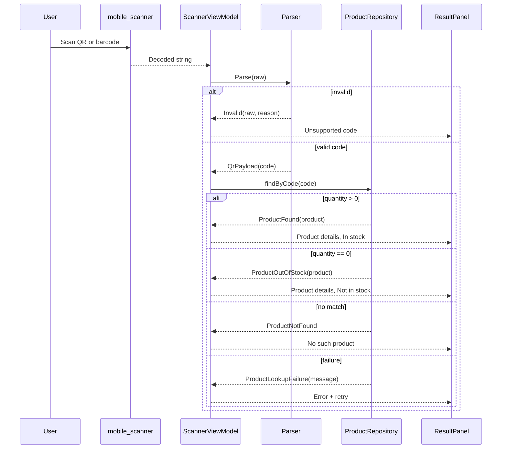
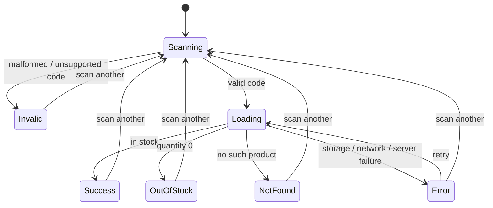

# Architecture

## Overview

## Layers

| Layer | Location | Responsibility | Must not |
|---|---|---|---|
| Auth | `lib/src/auth` | Sign-in contract, local demo, remote seam | Parse codes or render UI |
| Product model | `lib/src/models` | `Product` fields and stock state | Depend on UI |
| QR/barcode parsing | `lib/src/qr` | Validate and normalize scanned content | Use Flutter, camera, or I/O |
| Data | `lib/src/data` | Local asset and remote product lookup | Reference Flutter UI |
| State | `lib/src/state` | Login and scan state machines | Render widgets |
| UI | `lib/src/ui` | Login, Home, camera modes, results, language/sound controls | Contain parsing or HTTP logic |
| Services | `lib/src/services` | Cashier-style scan beep | Block scanning |
| Localization | `lib/l10n` | English/Azerbaijani/Russian strings | Hardcode UI text |

## Authentication and navigation flow

- Login is required; the camera does **not** start until “Scan code” is tapped.
- Local demo credentials are `test` / `test`.
- Remote auth is a provisional `POST {baseUrl}auth/login`.
- Sessions are in memory; passwords/tokens are not persisted or logged.
- The UI is localized in English, Azerbaijani, and Russian.
- A cashier-style scanner beep plays when a code is scanned; the camera stops after the
  result and the user returns Home to scan again.

## Scan modes

- **QR:** `BarcodeFormat.qrCode`.
- **Barcode:** EAN-13, EAN-8, UPC-A, UPC-E, Code 128, Code 39, Code 93, ITF,
  Codabar.

Mode changes reset scan state and recreate the scanner controller.

## Product lookup flow

Lookup matches product **ID**, **barcode**, or **QR payload**.

## State machine

`Loading`, `Success`, `OutOfStock`, and `Error` disable scanning. The same payload
is ignored. After a result the camera is stopped; “Scan another code” returns to
Home, and scanning starts again only from the Home Scan button.

## C# core

`Projects/MobileApp.CSharp` mirrors the parser, `Product` lookup, and state machine
in a pure `net10.0` library with a console test runner (45 checks). It has no
MAUI, Android, UI, camera, or APK. Authentication is Flutter-app-only.

## Backend

`Projects/Backend/ProductApi` is a minimal ASP.NET Core API using Npgsql.

- `GET /health`
- `GET /products`
- `GET /products/{code}` — matches ID, barcode, or QR payload
- `POST /products` — add or update a depot product
- Unknown product → `404`
- Out-of-stock product → `200` with `quantity: 0` and `inStock: false`

PostgreSQL schema and seed: `Root/Infrastructure/postgres/init/001_products.sql`.

## Key decisions

- **Flutter mobile app + pure C# core + C# API.** Flutter is the only Android
  app; the C# core is platform-free; the API owns PostgreSQL access.
- **QR and barcode.** One scanner screen with a mode switch.
- **Local-first.** The app works offline with `assets/products.json`; remote mode
  uses PostgreSQL through the API.
- **Explicit stock states.** In stock, out of stock, and no such product are
  distinct UI states.
- **No direct database access from mobile.** The app talks only to the API.
- **No remote product cache.** Every scan queries the API, so newly added depot
  products are recognized immediately.
- **Localized and subtle.** Three interface languages and one cashier-style scan beep.
- **No automatic URL opening.**
